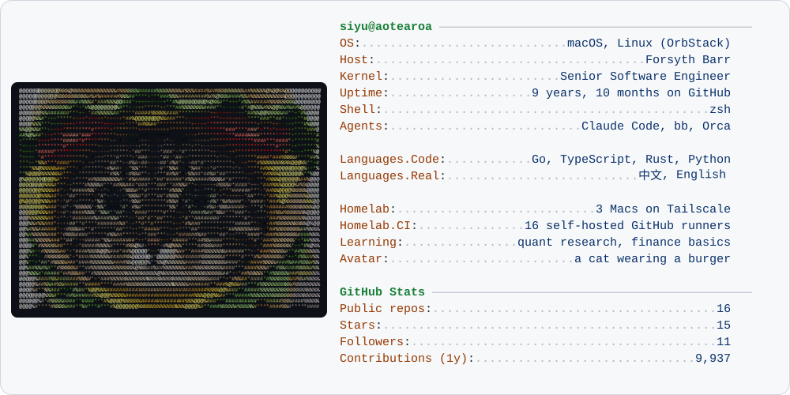

<a href="https://siyu.co.nz">
  <picture>
    <source media="(prefers-color-scheme: dark)" srcset="./dark_mode.svg">
    
  </picture>
</a>

### `$ whoami`

Senior software engineer in New Zealand. By day I work at Forsyth Barr. The rest of the time I build the tooling that lets coding agents do real work: plans in, reviewed pull requests out.

### `$ ls ~/building`

- [**keel**](https://github.com/SiyuQian/keel) — an agentic development environment on top of Orca: agents, terminals and code review in one desktop app.
- [**yanyu · 言语**](https://github.com/SiyuQian/yanyu) — desktop speech input with local recognition and on-device cleanup (Qwen3 on Apple Silicon).
- [**dev-pulse**](https://dev-pulse.siyu.co.nz) — a daily pulse of what I and my agents shipped.
- [**devpilot**](https://github.com/SiyuQian/devpilot) (archived) — where it started: a Go CLI that turned Trello cards into autonomous Claude Code runs.

### `$ cat ~/.agents-manifesto`

- **Plan first.** An agent with a written plan beats a smarter agent with a vague prompt.
- **Agents review agents.** Every change gets an isolated reviewer before a human looks at it.
- **Own the CI.** My runners live on Macs at home, so the feedback loop is fast and free.

### `$ git log --since=yesterday`

<!-- recent starts -->
- [**keel**](https://github.com/SiyuQian/keel) — Agent orchestration workbench, built on Orca (MIT) · pushed 2026-10-17
- [**yanyu**](https://github.com/SiyuQian/yanyu) — Yanyu is a personal desktop speech input app based on Handy, with local speech recognition. · pushed 2026-10-17
- [**quant-learning**](https://github.com/SiyuQian/quant-learning) — 从零开始的金融基础与量化研究学习记录：中文交互手册、笔记与实验。 · pushed 2026-10-13
- [**dev-pulse**](https://github.com/SiyuQian/dev-pulse) — no description yet · pushed 2026-10-03
- [**gocraft**](https://github.com/SiyuQian/gocraft) — no description yet · pushed 2026-08-31
<!-- recent ends -->

The card and this list rebuild every day from [`build.py`](./build.py). The ASCII art is my avatar: a cat in a burger hat.
